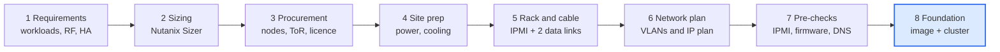
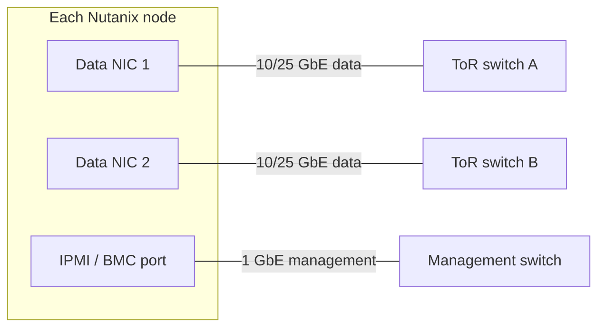

# Nutanix Deployment

## Table of Contents

1. [Overview](#1-overview)
2. [Phase 1: Requirements Gathering](#2-phase-1-requirements-gathering)
3. [Phase 2: Sizing the Cluster](#3-phase-2-sizing-the-cluster)
4. [Phase 3: Hardware and Licence Procurement](#4-phase-3-hardware-and-licence-procurement)
5. [Phase 4: Site Preparation](#5-phase-4-site-preparation)
6. [Phase 5: Racking, Stacking and Cabling](#6-phase-5-racking-stacking-and-cabling)
7. [Phase 6: Network Planning and Configuration](#7-phase-6-network-planning-and-configuration)
8. [Phase 7: Pre-Foundation Checklist](#8-phase-7-pre-foundation-checklist)
9. [Phase 8: Foundation (Next Step)](#9-phase-8-foundation-next-step)
10. [Post-Foundation Tasks](#10-post-foundation-tasks)
11. [Quick Revision Points](#11-quick-revision-points)

---

## 1. Overview

Before Foundation (Nutanix's imaging and cluster-creation tool) can be run, a series of planning, procurement, physical and network steps must be completed. Skipping or rushing any of them is the most common cause of failed or slow deployments.

**High-level flow:**

1. Gather customer requirements
2. Size the cluster
3. Select and procure hardware, licences and cables
4. Prepare the site (rack, power, cooling)
5. Rack, stack and cable the nodes
6. Plan and configure the network (switches, VLANs, IPs, DNS, NTP)
7. Run pre-Foundation checks
8. Run Foundation (image nodes and create the cluster)
9. Post-deployment tasks



*Foundation is the final step and only works once the earlier steps are complete.*

## 2. Phase 1: Requirements Gathering

Capture what the customer actually needs before choosing any hardware.

- Number and type of workloads (VMs, databases, VDI, containers, files/objects)
- Total vCPU, RAM and storage capacity per workload
- Performance needs (IOPS, latency, throughput)
- Growth forecast (typically 3 to 5 years)
- Availability needs: redundancy factor (RF2 or RF3), failure tolerance, DR and backup requirements
- Hypervisor choice (AHV is Nutanix's built-in hypervisor; ESXi is also supported)
- Site constraints: rack space, power, cooling, network speed available
- Licensing edition (e.g., NCI Starter, Pro, Ultimate) and add-ons

## 3. Phase 2: Sizing the Cluster

Turn the requirements into a node count and node configuration.

- Use the **Nutanix Sizer** tool to calculate nodes, CPU, RAM, and usable storage.
- Account for the Controller VM (CVM) overhead. Every node runs a CVM that consumes CPU and RAM.
- Account for **RF overhead**: RF2 keeps 2 copies of data, RF3 keeps 3, so usable capacity is lower than raw capacity.
- Leave room for **N+1** (survive one node failure with enough spare capacity to rebuild), plus growth headroom.
- Minimum cluster size: **3 nodes** for standard production clusters. 1-node and 2-node clusters exist for remote/branch offices, with limitations (a 2-node cluster needs a Witness VM).

## 4. Phase 3: Hardware and Licence Procurement

Buy hardware that matches the sizing output.

**Hardware options:**

- Nutanix NX appliances
- OEM platforms with Nutanix software (e.g., Dell, Lenovo, HPE, Fujitsu, Cisco)
- Other third-party hardware listed on the Nutanix Hardware Compatibility List (HCL)

**What to specify per node:**

| Component | Notes |
|---|---|
| CPU | Cores and clock speed per sizing |
| RAM | Includes CVM overhead |
| Storage | Hybrid (SSD + HDD) or all-flash / NVMe, sized per sizing |
| NICs | 10/25 GbE (or faster) data ports, minimum 2 for redundancy |
| Out-of-band management | IPMI / BMC port (iDRAC, iLO, etc.) |
| Cables | SFP+/SFP28 DAC or fibre with matching optics, plus 1 GbE copper for IPMI |
| Power | Redundant PSUs, PDUs |

**Also buy or arrange:**

- Top-of-rack (ToR) switches (at least two for redundancy; 10 GbE or higher recommended)
- Rack, PDUs, rails and cable management
- Nutanix software licences (matching the number of cores or nodes)

> **Correction note:** The original discussion mentioned buying servers, CPU, RAM, storage, NICs and cables. That is right, but licensing and ToR switches also belong in this phase, and compatibility must be checked against the Nutanix HCL when not using NX hardware.

## 5. Phase 4: Site Preparation

- Confirm rack space, power capacity, cooling and floor loading
- Confirm that dual power feeds are available if redundancy is required
- Confirm that the network uplinks and cabling paths to the core are available

## 6. Phase 5: Racking, Stacking and Cabling


1. Mount nodes in the rack and connect redundant power.
2. Connect each node's **IPMI/BMC** port to the management switch (1 GbE).
3. Connect each node's **data NICs** to the ToR switches. Use two links per node, one to each switch, for redundancy.
4. Label all cables and ports, and record the cabling map.
5. Power on nodes and verify that IPMI is reachable.



*Splitting the data links across two ToR switches keeps the node reachable if one switch fails; the IPMI link is separate.*

## 7. Phase 6: Network Planning and Configuration

### 7.1 VLANs

- **Management VLAN**: hypervisor hosts, CVMs and (commonly) Prism access
- **IPMI/out-of-band VLAN**: BMC interfaces (can be the same or separate)
- **VM / workload VLANs**: guest traffic
- Optional: backup, replication, storage-services VLANs

### 7.2 IP addressing

Each node needs **three IP addresses**:

1. IPMI (BMC)
2. Hypervisor host (AHV or ESXi)
3. CVM

The cluster additionally needs:

- **Cluster Virtual IP (VIP)** for Prism Element access
- Optional **Data Services IP** (for iSCSI/volume access)
- Subnet mask, default gateway, **DNS** servers and **NTP** servers

### 7.3 Switch configuration

- Configure ports as access or trunk ports as needed, with the required VLANs allowed
- Enable **PortFast / edge-port** behaviour on host-facing ports to avoid spanning-tree delays
- Jumbo frames are optional, but if used they must be consistent end to end
- Link aggregation (LACP) is optional. The AHV default bond mode is active-backup, which needs no switch-side configuration


## 8. Phase 7: Pre-Foundation Checklist

- [ ] IPMI reachable on every node with working credentials
- [ ] BIOS/BMC firmware compatible with the target AOS version
- [ ] IP plan finalised (IPMI, host, CVM per node, plus cluster VIP, DNS, NTP, gateway)
- [ ] VLANs and switch ports configured and tested
- [ ] Foundation VM, Foundation applet or Foundation Central available, with a version compatible with the target AOS
- [ ] AOS and hypervisor images downloaded (if nodes are not already factory-imaged to the right version)
- [ ] Workstation or Foundation VM on the correct network. Discovery of unconfigured nodes relies on IPv6 link-local, so it must be on the same layer-2 broadcast domain as the nodes (or use manual IP entry)
- [ ] Licence plan ready for after cluster creation

## 9. Phase 8: Foundation (Next Step)

Foundation performs:

- Node discovery
- Imaging (AOS and hypervisor, if required)
- Network and IP assignment
- **Cluster creation** (name, VIP, DNS, NTP, RF)

You can run it via the standalone Foundation VM (GUI on port 8000), the Foundation applet, or **Foundation Central** from Prism Central for remote or zero-touch deployments.

## 10. Post-Foundation Tasks

- Log in to Prism Element using the cluster VIP
- Run **NCC** health checks
- Configure licences, alerts/SMTP, and authentication
- Register the cluster with **Prism Central**
- Run **LCM** to update firmware and software to target versions
- Create storage containers and VM networks

## 11. Quick Revision Points

- Requirements lead to sizing, sizing leads to procurement.
- 3 IPs per node, plus 1 cluster VIP.
- Use 2 ToR switches and 2 NIC links per node for redundancy.
- IPMI must work before Foundation.
- Foundation does imaging plus cluster creation; LCM and NCC come after.


```


### 12.4 Troubleshooting Checklist

- [ ] Ping each IPMI address from the Foundation VM
- [ ] Open the IPMI web page (HTTPS) from the Foundation VM and log in
- [ ] Verify subnet mask and gateway for IPMI, host and CVM addresses
- [ ] Check that the IPMI credentials are correct
- [ ] Check VLAN tagging and trunk or access settings on the switch ports
- [ ] Check firewall and ACL rules between the Foundation VM subnet and the node subnets
- [ ] Confirm the Foundation version supports the target AOS version

### 12.5 Key Takeaway

Before starting Foundation, prove reachability from the Foundation VM to every IPMI IP and every planned host and CVM IP. Most "Foundation cannot connect" problems are network design problems, not Nutanix problems.
